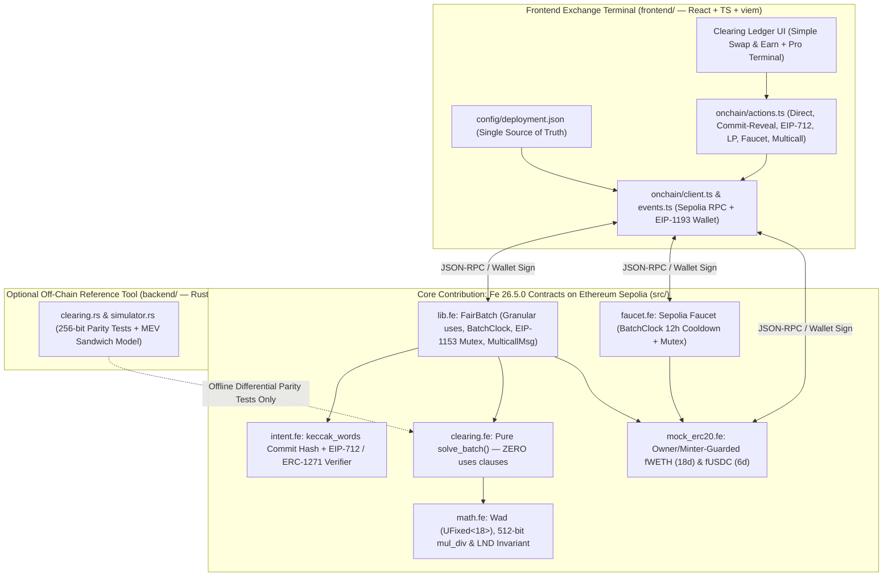

# FairBatch

**Pitch:** FairBatch is an MEV-resistant uniform-clearing batch exchange and Hybrid Coincidence-of-Wants (CoW) + Function-Maximizing AMM (FM-AMM) written in **Fe `26.5.0`** whose pricing engine (`src/clearing.fe`) is statically proven pure by Fe's capability system (`0` `uses` clauses), eliminating intra-batch sandwich extraction (`$0.00` bot profit) and arrival-order slippage on Ethereum Sepolia.

---

## The Problem

On sequential constant-product AMMs ($x \cdot y = k$), swaps execute one-by-one in block-builder order, causing three structural problems:

1. **Arrival-Order Unfairness:** Five identical `1 WETH -> USDC` swaps in one block receive five progressively worse prices solely due to transaction ordering.
2. **Intra-Block MEV Sandwich Extraction:** Searchers front-run pending swaps and back-run immediately after. Against five `1 WETH` sells into a `100 WETH / 300,000 USDC` sequential AMM (`30 bps` fee), an optimal sandwich bot extracts `$1,802.26 USDC` from user execution quality (verified in `backend/src/simulator.rs`).
3. **Loss-Versus-Rebalancing (LVR):** Sequential arbitrageurs capture inframarginal surplus while leaving $k = x \cdot y$ unchanged net of fees.

---

## Approach

FairBatch replaces sequential execution with discrete **uniform-price batch auctions** (`Open` -> `Reveal` -> `Ready to Settle` -> `Settled`) backed by an embedded **Function-Maximizing AMM (FM-AMM, Canidio & Fritsch 2023)** passive liquidity pool:

1. **Three Order Submission Modes ([`src/lib.fe`](./src/lib.fe), [`src/intent.fe`](./src/intent.fe)):**
   - **Direct Limit Orders (`submitDirectOrder`):** Single-step limit orders during the `Open` window.
   - **Sealed Commit-Reveal (`commitOrder` + `revealOrder` + `slashUnrevealed`):** Hides `(side, amount_in, limit_price, salt)` behind `keccak256` during `Open`, backed by a `Wei` reveal bond. Honest reveals refund the bond with a `200,000`-gas budget (compatible with smart wallets and EIP-7702 delegated accounts). Unrevealed commitments can be slashed permissionlessly after `reveal_deadline`, paying the forfeited ETH bond directly to the slasher caller and emitting `CommitmentSlashed(batch_id, commit_id, trader, slasher, forfeited_bond)`. Pending commitments reserve batch capacity so direct orders or intents cannot crowd out honest revealers.
   - **EIP-712 Signed Intents (`submitSignedIntent`):** Off-chain typed-data intents verified on-chain via `std::evm::eip712::Domain` and `std::evm::signature::is_valid_signature_now` (supporting EOA `secp256k1` and **ERC-1271** smart-contract wallets, with sequential nonces, batch binding, and `Timestamp` deadlines) during `Open` or `Reveal`.

2. **Pure Uniform Hybrid CoW + FM-AMM Clearing ([`src/clearing.fe`](./src/clearing.fe), [`src/math.fe`](./src/math.fe)):**
   - Normalizes raw token amounts ($\le 18$ decimals, deployed with `18`-decimal `fWETH` and `6`-decimal `fUSDC`) to 18-decimal `Wad` (`UFixed<18>`).
   - Solves for the unique uniform clearing price:
     $$p^* = \frac{R_y + 2 D_y}{R_x + 2 S_x}$$
     (degenerating to pure P2P $p^* = D_y / S_x$ when $R_x = R_y = 0$, and pinning $p^* = p_{\text{limit}}$ with floor-rounded pro-rata fills when a marginal limit tier crosses equilibrium).
   - Overlapping buyer and seller flow matches peer-to-peer (CoW) with zero price impact; only the net imbalance clears against passive reserves $(R_x, R_y)$, growing $k' = R_x' R_y' \ge R_x R_y$ (Liquidity-Nondecreasing invariant, verified on-chain with 512-bit `full_mul`).

3. **Pull-Over-Push Claims, Protected Liquidity, and Testnet Faucet:**
   - `settleBatch()` executes **zero external token transfers** — entitlements are written to `OrderReceipt` storage so a blacklisted token holder cannot revert batch settlement. Traders withdraw via `claim(batch_id, order_id)` or batch-claim atomically with `multicall(bytes[])` (`MulticallMsg`).
   - **FM-AMM Liquidity (`addLiquidity`, `addLiquidityLocked`, `removeLiquidity`):** Enforces caller-supplied slippage bounds (`min_shares`, `min_base`, `min_quote`), pulls only the matched reserve ratio on subsequent adds (leaving excess on the over-supplied side untouched in the LP's wallet), rounds strictly in favor of the pool, burns `MINIMUM_LIQUIDITY = 1_000` shares to `Address::zero()` on first deposit, and supports optional LP time-locking via `addLiquidityLocked` / `getLiquidityLock`.
   - **Access-Controlled Tokens & Sepolia Faucet ([`src/mock_erc20.fe`](./src/mock_erc20.fe), [`src/faucet.fe`](./src/faucet.fe)):** `fWETH` and `fUSDC` restrict `mint` to `owner` and an authorized `minter` (`Faucet`), and restrict `mintAndApprove`, `setMinter`, and `setBlacklisted` to `owner`. The standalone `Faucet` contract is pre-funded with `2,000 fWETH` and `1,000,000 fUSDC` and drips `1 fWETH + 100 fUSDC` per wallet every `12 hours`.

---

## Why Fe — Highlights, File Paths & Test Coverage

FairBatch's core contract suite (`src/*.fe`) is built around **Fe `26.5.0`** features rather than Solidity-style patterns translated line-by-line:

| Fe `26.5.0` Highlight | Implementation File(s) | Verified Fe Test(s) in [`src/tests.fe`](./src/tests.fe) | Concrete Engineering Benefit |
| :--- | :--- | :--- | :--- |
| **Zero-effect pure clearing (`uses ()`) & MEV proof** | [`src/clearing.fe`](./src/clearing.fe), [`src/math.fe`](./src/math.fe) | `proof_mev_sandwich_zero_profit`, `property_order_permutation_invariance`, `property_lnd_invariant_across_imbalanced_regimes` | Every pricing, sorting, and invariant function declares zero `uses` clauses — the compiler statically forbids storage access, external calls, logs, and `Ctx` inside `solve_batch`. Tests prove `$0` sandwich profit, order-permutation invariance, and 512-bit LND ($R_x' R_y' \ge R_x R_y$) across imbalanced regimes. |
| **Custom `BatchClock` effect & `MockClock` injection** | `BatchClock` / `EvmClock` in [`src/lib.fe`](./src/lib.fe) & [`src/faucet.fe`](./src/faucet.fe) | `effect_mocked_clock_transitions`, `effect_lp_lock_expiry_before_and_after_unlock`, `effect_revert_lp_lock_rejects_locked_shares_before_unlock`, `effect_faucet_cooldown_before_and_after_with_mock_clock`, `effect_revert_faucet_cooldown_active_with_mock_clock`, `effect_slashable_window_mock_clock`, `effect_revert_open_window_blocked_when_ready_to_settle`, `effect_revert_reveal_window_blocked_when_ready_to_settle`, `effect_revert_intent_window_blocked_when_ready_to_settle` | Production handlers inject `with (BatchClock = EvmClock { ts: ctx.timestamp() })`, while `fe test` injects `MockClock` to deterministically verify batch phase transitions, slash eligibility, LP lock expiry, and 12-hour faucet cooldowns without timestamp-warp cheatcodes. |
| **Transient-storage `Mutex` (EIP-1153 `TLOAD`/`TSTORE`)** | `std::evm::mutex::Mutex` in [`src/lib.fe`](./src/lib.fe) & [`src/faucet.fe`](./src/faucet.fe) | `evm_reentrancy_mutex_blocks_malicious_token_callback` | Zero hand-rolled storage lock slots; reentrancy guards compile directly to Cancun transient storage (`8` `TLOAD`, `16` `TSTORE` in `FairBatch.runtime.bin`). |
| **Std EIP-712 & ERC-1271 signature verification** | `std::evm::eip712::{Domain, digest}` & `std::evm::signature::is_valid_signature_now` in [`src/intent.fe`](./src/intent.fe) & [`src/lib.fe`](./src/lib.fe) | `evm_eip712_eoa_signed_intent_gasless_relayer`, `evm_eip712_erc1271_smart_wallet_intent`, `evm_revert_replayed_eip712_intent`, `evm_revert_expired_eip712_deadline`, `evm_revert_eip712_skipped_nonce`, `evm_revert_eip712_wrong_batch_id` | Standard-library typed-data hashing and unified EOA (`secp256k1`) + smart-wallet (ERC-1271) verification with zero vendored Solidity libraries. |
| **Fixed-point `Wad` (`core::fixed::Wad` / `UFixed<18>`)** | [`src/math.fe`](./src/math.fe), [`src/clearing.fe`](./src/clearing.fe) | Exercised across `proof_mev_sandwich_zero_profit`, `property_order_permutation_invariance`, `property_lnd_invariant_across_imbalanced_regimes`, and all clearing/math unit tests | Type-safe 18-decimal price and ratio arithmetic paired with `core::num::{full_mul, isqrt, mul_div, mul_div_ceil}` and `Wei`/`Timestamp`/`Duration`/`Address` domain units. |
| **Std `multicall` (`MulticallMsg`)** | `std::evm::multicall::{MulticallMsg, multicall}` in [`src/lib.fe`](./src/lib.fe) | `evm_multicall_batch_claim_across_orders`, `evm_revert_payable_multicall_double_value_attack` | Atomic batch claiming (`multicall([claim(...), ...])`) and atomic settle+swap (`multicall([settleBatch(), submitDirectOrder(...)])`) while rejecting payable `msg.value` reuse attacks. |
| **Granular capability projections (`uses (...)`) & `Option`/enums** | [`src/lib.fe`](./src/lib.fe), [`src/faucet.fe`](./src/faucet.fe), [`src/mock_erc20.fe`](./src/mock_erc20.fe), [`src/types.fe`](./src/types.fe) | Covered across all 69 Fe tests | Each `recv` arm declares only the storage fields and effects it touches (e.g., `Claim` cannot mutate `pool` or `batches`); `Side` enum and `Option<Address>` enforce exhaustive `match` checks. |

---

## Fe `26.5.0` Tooling Feedback

### Compiler Issues & Workarounds Encountered

1. **No timestamp-warp cheatcode in `fe test` (`std::evm::Evm`):** `evm.timestamp()` is read-only inside `#[test]` EVM tests. **Workaround:** we defined the `BatchClock` effect trait in [`src/lib.fe`](./src/lib.fe) and reused it in [`src/faucet.fe`](./src/faucet.fe) so batch phases, slash windows, LP lock expiry, and faucet cooldown expiry are tested deterministically via `with (BatchClock = MockClock { ... })`, while EVM integration tests that settle immediately deploy with `Duration::zero()` windows.
2. **No secp256k1 signing helper in `fe test`:** EOA EIP-712 tests (`evm_eip712_eoa_signed_intent_gasless_relayer`, `evm_revert_replayed_eip712_intent`) hardcode an offline-signed `(r, s, v)` vector tied to `FairBatch`'s deterministic `CREATE2` address; any change to `FairBatch.bin` or `MockERC20.bin` requires recomputing that test vector. (ERC-1271 intent tests avoid this via `TraderActor::AuthorizeDigest`.)
3. **Ascending-only `core::sort::sort`:** `core::sort::sort` sorts ascending by `Ord`, so buyer orders are sorted ascending and then reversed with `core::sort::reverse` ([`src/clearing.fe`](./src/clearing.fe)).
4. **Hex literals reject underscore separators:** Decimal literals allow `_` (`1_000_000`), whereas hex literals with underscores (e.g., `0x7702_CAFE`) fail parsing (`error[1-0001]`), so tests use contiguous hex (`0x7702CAFE`).
5. **Windows CRLF handling in `fe fmt --check`:** `fe fmt --check` treats `\r\n` vs `\n` as a full-file diff on Windows checkouts. **Workaround:** enforce `*.fe text eol=lf` in [`.gitattributes`](./.gitattributes).
6. **All contracts in the ingot compile to `out/`:** `fe build` emits bytecode/ABI artifacts for test-only helper contracts (`TraderActor`, `MaliciousReentrantERC20` in [`src/tests.fe`](./src/tests.fe)) alongside production contracts (`FairBatch`, `Faucet`, `MockERC20`).

### Gas Overhead of `approve` & Order Calls (Measured Facts vs. Unmeasured Observations)

- **Measured fact (`approve`):** On standard local Cancun EVM, `MockERC20.approve` costs **`44,308` gas** for a new allowance slot (`0 -> max`) and **`26,980` gas** for an existing-slot update — comparable to standard ERC-20 implementations. The **`126,228` gas** seen on live Sepolia is therefore **not** Fe `approve` codegen bloat; direct read-only `eth_estimateGas` probing on Sepolia block `12,182,495` measured `126,950` (new slot) vs. `28,294` (existing-slot update), a **`+98,656` gas** surcharge for creating 1 new storage slot under Sepolia's active EIP-8037 state-creation gas repricing (vs. `+17,328` on Cancun).
- **Measured fact (order submission & settlement):** On local Cancun EVM (separate cold transactions), `submitDirectOrder` uses `160,463` gas, `commitOrder` uses `133,528–136,004`, `revealOrder` uses `259,668`, `submitSignedIntent` uses `212,511`, and `settleBatch` uses `271,552` (0 orders) to `931,005` (3 orders). On live Sepolia (EIP-8037 active), those same calls use `527,943`, `485,120–495,120`, `989,172`, `763,208`, and `1,063,232` (0 orders) to `4,022,905` (3 orders).
- **Observation *(unmeasured against an equivalent Solidity re-implementation)*:** Fe `storage` structs (`OrderReceipt` with 10 fields, `BatchMeta` with 11 fields, `Commitment` with 5 fields) currently lay out each field in its own 32-byte storage slot without automatic sub-word packing of `u8`/`bool`/`Address` fields. Writing ~5–10 separate new slots per order appears to be a primary driver of order/settlement gas — and is amplified ~4× on EIP-8037 networks. Similarly, Sonatina's current monomorphization and dispatch codegen brings `FairBatch` to `23,038` runtime bytes (`93.74%` of EIP-170); automatic storage packing and code-size optimization passes would materially improve both gas and deployment headroom for complex Fe contracts.

---

## Architecture

The live exchange frontend connects **directly to Ethereum Sepolia via `viem`** using [`config/deployment.json`](./config/deployment.json) as the single source of truth — **no REST backend is required**. First-time visitors land in **Simple** mode (plain-language protected swap + Earn tab with guided steps), while judges and power users can switch to **Pro** mode for the full clearing ledger terminal (all 3 order modes, depth/price chart, MEV sandwich simulator, batch console, and claims ledger). The Rust crate in [`backend/`](./backend) is kept strictly as an optional off-chain reference/parity verifier and sequential-AMM MEV sandwich simulator (not the core contribution).



| Path | Responsibility |
| :--- | :--- |
| [`fe.toml`](./fe.toml) | `fair_batch` ingot manifest (`version = "0.1.0"`, Fe `26.5.0`). |
| [`src/lib.fe`](./src/lib.fe) | `FairBatch` exchange contract: batch lifecycle, 3 order modes, commit-slot reservation, slasher-paid `slashUnrevealed`, pull-based `claim`, `MulticallMsg`, slippage-protected LP add/remove with `MINIMUM_LIQUIDITY` burn & optional locking, `BatchClock` trait. |
| [`src/clearing.fe`](./src/clearing.fe) | **Zero-effect (`uses ()`)** Hybrid CoW + FM-AMM uniform batch solver, marginal-tier pro-rata rationing, directional rounding bounds, and 512-bit solvency/LND assertions. |
| [`src/math.fe`](./src/math.fe) | Pure `Wad` (`UFixed<18>`) helpers, 18d/6d scaling, 512-bit `full_mul`/`mul_div` comparisons, `verify_lnd_invariant`, and `compute_initial_lp_shares`. |
| [`src/intent.fe`](./src/intent.fe) | `keccak_words` commit-reveal hashing, EIP-712 `SignedOrder` hashing, and `is_valid_signature_now` (EOA + ERC-1271) with zero-trader, batch, nonce, and deadline checks. |
| [`src/storage.fe`](./src/storage.fe) | `MarketConfig`, `PoolState`, `BatchMeta`, and `LiquidityLock` storage records. |
| [`src/types.fe`](./src/types.fe) | `Side` enum, `#[abi]` structs, `#[event]` definitions, and protocol constants (`MAX_ORDERS_PER_BATCH = 64`, `MIN_ORDER_AMOUNT = 1_000`, `MINIMUM_LIQUIDITY = 1_000`). |
| [`src/faucet.fe`](./src/faucet.fe) | Standalone Sepolia `Faucet` (`1 fWETH + 100 fUSDC` / `12h`) with `BatchClock` cooldown helpers and EIP-1153 `Mutex`. |
| [`src/mock_erc20.fe`](./src/mock_erc20.fe) | Access-controlled `MockERC20` (`owner`/`minter`-restricted `mint`, owner-only `mintAndApprove`/`setMinter`/`setBlacklisted`) deployed as `fWETH` (18d) and `fUSDC` (6d). |
| [`src/tests.fe`](./src/tests.fe) | **69 Fe tests** covering clearing math, properties, MEV zero-profit proof, `MockClock` transitions (batches, LP locks, faucet, slashing), full EVM lifecycles, 64-order settlement, and security revert boundaries. |
| [`config/deployment.json`](./config/deployment.json) | Single source of truth for live Ethereum Sepolia contract addresses, token metadata, market windows, and faucet config. |
| [`deployments/sepolia.json`](./deployments/sepolia.json) | Full Sepolia deployment manifest with tx hashes, block numbers, gas usage, and Etherscan links. |
| [`frontend/`](./frontend) | React 18 + TypeScript + TailwindCSS + `viem` exchange terminal connected directly to Sepolia (**35 Vitest tests**). |
| [`backend/`](./backend) | Optional Rust reference solver & sequential-AMM MEV simulator (**30 Cargo tests**, see [`backend/README.md`](./backend/README.md)). |
| [`scripts/`](./scripts) | PowerShell deployment and verification scripts (`deploy_sepolia.ps1`, `prepare_deployment.ps1`, `check_setup.ps1`). |
| [`docs/`](./docs) | [`PROJECT_STRUCTURE.md`](./docs/PROJECT_STRUCTURE.md), [`RESEARCH_AND_FEASIBILITY.md`](./docs/RESEARCH_AND_FEASIBILITY.md), [`design/CLEARING_LEDGER.md`](./docs/design/CLEARING_LEDGER.md), and [`screenshots/`](./docs/screenshots). |

---

## Build, Test & Demo (Reproducible From a Clean Clone)

### 1. Clone

```sh
git clone https://github.com/Asif2902/FairBatch.git
cd FairBatch
```

### 2. Smart Contracts (Fe `26.5.0` — Core Contribution)

Install Fe `v26.5.0` via [`feup`](https://fe-lang.org/getting-started/installation/):

```sh
curl -fsSL https://raw.githubusercontent.com/argotorg/fe/master/feup/feup.sh | bash -s -- --version v26.5.0
```

Verify formatting, type-checking, all **69 Fe tests**, and build EVM bytecode + ABI artifacts into `out/`:

```sh
fe --version      # Verified with: fe 26.5.0 (3dab95f)
fe fmt --check
fe check
fe test           # 69 passed; 0 failed
fe build          # Emits out/{FairBatch,Faucet,MockERC20}.{bin,runtime.bin,abi.json}
```

### 3. Live Sepolia Web Terminal (`frontend/`)

Requires Node.js 20+ and `npm`. No `.env` file or local backend is needed — addresses are loaded directly from [`config/deployment.json`](./config/deployment.json):

```sh
cd frontend
npm ci
npm test          # 35 passed; 0 failed (Vitest)
npm run build     # tsc -b && vite build
npm run dev       # Opens http://localhost:5173 connected to Ethereum Sepolia
```

In the browser on Ethereum Sepolia (Chain ID `11155111` with MetaMask or any EIP-1193 wallet):
1. Connect your wallet to **Sepolia** and click **Get Test Tokens** / **Claim Faucet** (`1 fWETH + 100 fUSDC` every 12 hours).
2. Complete a protected swap in **Simple** mode (or switch to **Pro** mode to test all three order modes: **Direct**, **Sealed Commit-Reveal**, and **EIP-712 Signed Intent**).
3. Add flexible or optionally time-locked LP liquidity in the **Earn** / **Liquidity** panel and test partial/unlocked withdrawal.
4. Once `reveal_deadline` passes, settle the batch (permissionless) to clear all orders at one uniform price $p^*$, slash any unrevealed commitment to collect its ETH bond bounty, and claim payouts individually or via **Multicall Claim**.

### 4. Optional Off-Chain Rust Reference Verifier (`backend/`)

Requires stable Rust (`cargo` 1.80+):

```sh
cd backend
cargo clippy --all-targets -- -D warnings
cargo test        # 30 passed; 0 failed (20 unit + 10 integration/parity tests)
```

---

## Contract Size (EIP-170)

Compiled with `fe 26.5.0 (3dab95f)` (Sonatina backend) and verified on-chain via `eth_getCode` on Ethereum Sepolia:

| Contract | Static Runtime (`out/*.runtime.bin`) | Deployed On-Chain Runtime (`eth_getCode`) | EIP-170 Cap (`24,576` B) | Remaining Headroom |
| :--- | :---: | :---: | :---: | :---: |
| **`FairBatch`** | `22,686` bytes | **`23,038` bytes** *(+`352` immutable bytes)* | **`93.74%`** | **`1,538` bytes** |
| **`MockERC20`** (`fWETH` / `fUSDC`) | `1,530` bytes | `1,594` bytes *(+`64` immutable bytes)* | `6.49%` | `22,982` bytes |
| **`Faucet`** | `1,186` bytes | `1,346` bytes *(+`160` immutable bytes)* | `5.48%` | `23,230` bytes |

- **Verified Cancun/Shanghai Opcodes (`out/FairBatch.runtime.bin`):** `PUSH0 = 342`, `MCOPY = 14`, `TLOAD = 8`, `TSTORE = 16`.

---

## Live Sepolia Verification

All contracts were compiled from frozen Fe `26.5.0` source and deployed from [`0x7d9Cb2994D86B6a4e65761B5d81DADa69ce54a7f`](https://sepolia.etherscan.io/address/0x7d9Cb2994D86B6a4e65761B5d81DADa69ce54a7f) on **Ethereum Sepolia (`Chain ID 11155111`)** (recorded in [`config/deployment.json`](./config/deployment.json) and [`deployments/sepolia.json`](./deployments/sepolia.json)).

- **Verified On-Chain `domainSeparator()`:** `0x5f0204041a131fe55ebf032359d28559fb9d9caeddf81c37e11fcb05fc6c8ef5`

### Deployed Contracts & Setup

| Contract / Setup Action | Address / Details | Transaction Hash (Etherscan) | Block | Sepolia Gas Used |
| :--- | :--- | :--- | :---: | :---: |
| **`fWETH` (`18` decimals)** | [`0xe9903189bf3e418759feb26f11a7d1c99be0e556`](https://sepolia.etherscan.io/address/0xe9903189bf3e418759feb26f11a7d1c99be0e556) | [`0x5b3f1800...21d990b`](https://sepolia.etherscan.io/tx/0x5b3f18005b6d6344eef187eec18456300a1aaf26f0a1cb4241b527b9a21d990b) | `12176749` | `2,676,774` |
| **`fUSDC` (`6` decimals)** | [`0xbd2c54af6dd7e5e14d5b97d393eb2c8e2e8ebcca`](https://sepolia.etherscan.io/address/0xbd2c54af6dd7e5e14d5b97d393eb2c8e2e8ebcca) | [`0xd15e031b...90aba0fbe`](https://sepolia.etherscan.io/tx/0xd15e031b8141c028dcefdaeecbb2dce1366c976dca004b0f9a11ab290aba0fbe) | `12176750` | `2,676,774` |
| **`FairBatch` Exchange** | [`0x6fa21b7ada82e8b04fca51fdc60793c3fd80265f`](https://sepolia.etherscan.io/address/0x6fa21b7ada82e8b04fca51fdc60793c3fd80265f) | [`0x6ed5ad01...3d8c9ff91`](https://sepolia.etherscan.io/tx/0x6ed5ad0144aedeb3c5cd4e5d91d54ccda9d2d8b58d64a5467e757573d8c9ff91) | `12176751` | `36,300,761` |
| **`Faucet` (`1 fWETH + 100 fUSDC / 12h`)** | [`0xe355220e8e9a650d082d49f130f0bfe344a792c7`](https://sepolia.etherscan.io/address/0xe355220e8e9a650d082d49f130f0bfe344a792c7) | [`0x8a2886ba...238078b48`](https://sepolia.etherscan.io/tx/0x8a2886ba04e1986c8257011ab23f596808d704374acd5f1753d0ad0238078b48) | `12176752` | `2,294,323` |
| **`setMinter(Faucet)` (`fWETH` / `fUSDC`)** | Authorizes `Faucet` as token minter | [`0xe1006995...1d607e3`](https://sepolia.etherscan.io/tx/0xe10069956ae7f3ab6bb2139831d4f0db89583e5ea51ba788d85fb2e3f1d607e3) / [`0xadb15e76...1ec43097`](https://sepolia.etherscan.io/tx/0xadb15e76c7fc89c474b17a7abe179072c6e172819c6a190dde959fd61ec43097) | `12176753` / `12176754` | `125,928` / `125,928` |
| **Fund `Faucet` (`2,000 fWETH`, `1,000,000 fUSDC`)** | Pre-funded faucet custody | [`0xbb3b600a...dd2f179c`](https://sepolia.etherscan.io/tx/0xbb3b600a737b14e67bd1d19603879d62aa28587fa6cb89729ed09c1ddd2f179c) / [`0x13e3124c...ce9f26cc`](https://sepolia.etherscan.io/tx/0x13e3124ce8e3417b2af3b0a194a3e2a3be5f5f3435a4ae9664d1e9a5ce9f26cc) | `12176755` / `12176756` | `236,416` / `236,380` |
| **`seedReserves(100e18, 300000e6)`** | Initial pool `100 fWETH / 300,000 fUSDC` | [`0xfd3f9db3...1aff12065`](https://sepolia.etherscan.io/tx/0xfd3f9db3779324372d0b3d3e1dcc79e3a82fa88f930ac5203c9ec931aff12065) | `12176759` | `811,614` |

### End-to-End Verification Transactions (Faucet, Approve, 3 Order Modes, Settle, Slash, Claim, Multicall)

Every core protocol workflow was executed on live Ethereum Sepolia against [`0x6fa21b7ada82e8b04fca51fdc60793c3fd80265f`](https://sepolia.etherscan.io/address/0x6fa21b7ada82e8b04fca51fdc60793c3fd80265f) and [`0xe355220e8e9a650d082d49f130f0bfe344a792c7`](https://sepolia.etherscan.io/address/0xe355220e8e9a650d082d49f130f0bfe344a792c7):

| Step | Category | Action | Transaction Hash (Etherscan) | Block | Sepolia Gas Used |
| :---: | :--- | :--- | :--- | :---: | :---: |
| 1 | **Faucet** | `Faucet.claim()` (`1 fWETH + 100 fUSDC`) | [`0x805bd93c...2493344`](https://sepolia.etherscan.io/tx/0x805bd93c453fca5e130677b3ca235e5270ea49522c298413060d8f3822493344) | `12176768` | `389,271` |
| 2 | **Approve** | `fWETH.approve(FairBatch, max)` | [`0xd0eac672...7c9795b`](https://sepolia.etherscan.io/tx/0xd0eac67270e7e7a83ed1dd712bd51f97c31be97296d0bb1214e2f4e377c9795b) | `12176769` | `126,228` |
| 3 | **Approve** | `fUSDC.approve(FairBatch, max)` | [`0x28366506...9c5f0454`](https://sepolia.etherscan.io/tx/0x28366506d913c717b5b0107562723aa086c46be32db4d459aa1dbbff9c5f0454) | `12176770` | `126,228` |
| 4 | **Liquidity** | `addLiquidity(0.01 fWETH, 50 fUSDC, 1)` (used `30 fUSDC`, unused `20 fUSDC` untouched) | [`0x92ba0538...4da5014c`](https://sepolia.etherscan.io/tx/0x92ba05389e869fb32e5084861b6ab87ac7da0c0e985d734cea8ef4fe4da5014c) | `12176771` | `160,099` |
| 5 | **Liquidity** | `removeLiquidity(shares, minBase, minQuote)` (pool-favorable floor rounding) | [`0x697d7d24...7fd9e6ab`](https://sepolia.etherscan.io/tx/0x697d7d2406828093010b01283f4c3377a302c7ed49ab3f86b0457e277fd9e6ab) | `12176773` | `139,284` |
| 6 | **Order Mode 1** | **Direct Order** — `submitDirectOrder` (Batch `#3`, `orderId = 0`, sell `0.05 fWETH`) | [`0x469148bb...a67840f8`](https://sepolia.etherscan.io/tx/0x469148bb4bc2d1e8005859b413effad161bf30229cdbfd52cc0f2151a67840f8) | `12180112` | `527,943` |
| 7 | **Order Mode 2** | **Sealed Commit** — `commitOrder` (Batch `#3`, `commitId = 0`, `0.0001 ETH` bond) | [`0x633aae5d...c6bd6a7`](https://sepolia.etherscan.io/tx/0x633aae5d4953343d12c8d2d58b10d8edade6eb28b94e9da97c5299a3ec6bd6a7) | `12180114` | `485,120` |
| 8 | **Order Mode 2** | **Unrevealed Commit** — `commitOrder` (Batch `#3`, `commitId = 1`, `0.0001 ETH` bond for slash) | [`0xbf433cb7...57bf8e5`](https://sepolia.etherscan.io/tx/0xbf433cb70e31c3b58f0eac018d72d499e0cb7b6c6f11f303f1844d42957bf8e5) | `12180115` | `495,120` |
| 9 | **Order Mode 2** | **Reveal Order** — `revealOrder` (Batch `#3`, `orderId = 1`, buy `50 fUSDC`, bond refunded) | [`0xbe6d1e7e...4eb2fba`](https://sepolia.etherscan.io/tx/0xbe6d1e7e349df0094ac23f6f74c95c6ce84e8e4ee8bf272702a4e0bf74eb2fba) | `12180119` | `989,172` |
| 10 | **Order Mode 3** | **EIP-712 Signed Intent** — `submitSignedIntent` (Batch `#3`, `orderId = 2`, sell `0.02 fWETH`) | [`0xa9cd90e6...da27ee5`](https://sepolia.etherscan.io/tx/0xa9cd90e6b61c4910c7fc6c2e5a8d88d24b9ce81fe5cb1d90b0d4e86e9da27ee5) | `12180120` | `763,208` |
| 11 | **Settle** | `settleBatch()` (Batch `#3`: 3 orders cleared at $p^* = \$2,993.813253$, `0.016701 fWETH` CoW) | [`0xf83aac98...0937bde`](https://sepolia.etherscan.io/tx/0xf83aac9811913a088ec0b57010b091afb100b3ccdefa66e8bf2efec5e0937bde) | `12180124` | `4,022,905` |
| 12 | **Slash** | `slashUnrevealed(3, 1)` (pays `0.0001 ETH` forfeited bond to slasher caller) | [`0x4f4168b7...3190554`](https://sepolia.etherscan.io/tx/0x4f4168b78dffd0c0a87d8f2709e0488e70497892c6db80306b3626e333190554) | `12180125` | `152,361` |
| 13 | **Claim** | `claim(3, 0)` (single pull claim) | [`0x6ed98007...a4ddb1`](https://sepolia.etherscan.io/tx/0x6ed98007cfb48c8bec823865976501895228b9f17feba23b02438c30a2a4ddb1) | `12180128` | `82,456` |
| 14 | **Multicall** | `multicall([claim(3, 1), claim(3, 2)])` (atomic batch claim) | [`0xa6d27d21...811dd3e`](https://sepolia.etherscan.io/tx/0xa6d27d2179434b5e8ac0778e1d8263022ee9a2f78ba0a66debd9d851d811dd3e) | `12180129` | `158,150` |
| 15 | **Multicall** | `multicall([settleBatch(), submitDirectOrder(...)])` (atomic settle + swap in Simple UI) | [`0x023e03bc...bfecb9e`](https://sepolia.etherscan.io/tx/0x023e03bcfc8d4e4ab1c3c9d3d75bb5c85e929b2d10c613f37479c24dfbfecb9e) | `12182252` | `1,568,581` |

Additional live Sepolia `settleBatch()` receipts used for the gas scaling table below:
- **0 orders (Batch `#1`):** [`0x021a019b...7b0ac2f`](https://sepolia.etherscan.io/tx/0x021a019bac85866ad7fa604fd142d88d81d7a852b852c53ef78d4056c7b0ac2f) (block `12176774`, `1,063,232` gas)
- **1 order (Batch `#2`):** [`0x0e83d26b...6da1346`](https://sepolia.etherscan.io/tx/0x0e83d26bc428f5f6bc577bab3280395ec5544100c46a96f37e58585736da1346) (block `12180111`, `1,995,245` gas)
- **2 orders (Batch `#5` & `#7`):** [`0x0abce2bc...edc4d5ef`](https://sepolia.etherscan.io/tx/0x0abce2bcf7b09850d29fb2b9a07df3ee79bb973a9b39bbb12629c6e9edc4d5ef) (block `12180935`, `2,790,734` gas) and [`0xa1fb0f19...498277f8`](https://sepolia.etherscan.io/tx/0xa1fb0f1997e9b2ae47d2272ab08a409d6c8e67fcdf67333bc6bbd635498277f8) (block `12182264`, `2,790,734` gas)

---

## Gas Benchmarks (Local Cancun EVM vs. Live Ethereum Sepolia)

### Measurement Methodology (Cold Storage & Block Gas Limits)

- **Local Cancun EVM measurements:** Executed against the exact frozen `fe 26.5.0` artifacts (`out/{FairBatch,Faucet,MockERC20}.bin`) on local Foundry `anvil --hardfork cancun`. Every deployment, approval, order submission, settlement, slash, and claim runs as a **separate standalone transaction**, so EIP-2929 account/storage access starts **cold** on every call. Pre-seeded pool reserves (`R_x`, `R_y`) and the active `BatchMeta` already hold non-zero values (updating existing slots), while each newly written `OrderReceipt`, `Commitment`, and newly opened `BatchMeta` transitions `0 -> non-zero` at Cancun's `20,000`-gas new-slot `SSTORE` cost.
- **Block gas limits used for `%` figures:**
  - **Local Cancun column:** **`36,000,000` gas** (Ethereum L1 Cancun/Pectra mainnet block gas limit; also note the `16,777,216` EIP-7825 per-transaction cap).
  - **Live Sepolia column:** **`200,000,000` gas** (measured directly on Sepolia blocks `12,176,759` through `12,182,495`, where `block.gasLimit` is `199,804,689–200,000,000`).

### Side-by-Side Operation & Settlement Gas Table

| Operation | Local Cancun EVM (Cold Tx) | % of `36M` L1 Block | Live Sepolia (`eth_getTransactionReceipt`) | % of `200M` Sepolia Block | Sepolia / Cancun Ratio |
| :--- | :---: | :---: | :---: | :---: | :---: |
| `MockERC20` Creation (`1,594` B) | `401,954` | `1.12%` | `2,676,774` | `1.34%` | `6.66×` |
| `Faucet` Creation (`1,346` B) | `349,285` | `0.97%` | `2,294,323` | `1.15%` | `6.57×` |
| `FairBatch` Creation (`23,038` B) | `5,150,321` | `14.31%` | `36,300,761` | `18.15%` | `7.05×` |
| `Faucet.claim()` | `116,011` | `0.32%` | `389,271` | `0.19%` | `3.36×` |
| `fWETH.approve` (`0 -> max`, **new slot**) | `44,308` | `0.12%` | `126,228` | `0.06%` | `2.85×` |
| `fWETH.approve` (**existing-slot update**) | `26,980` | `0.07%` | `28,294` *(read-only `eth_estimateGas`)* | `0.01%` | **`1.05×`** |
| `seedReserves(100e18, 300000e6)` | `218,438` | `0.61%` | `811,614` | `0.41%` | `3.72×` |
| `addLiquidity` (existing LP) | `93,299` | `0.26%` | `160,099` | `0.08%` | `1.72×` |
| `removeLiquidity` | `65,636` | `0.18%` | `139,284` | `0.07%` | `2.12×` |
| `submitDirectOrder` (Mode 1) | `160,463` | `0.45%` | `527,943` | `0.26%` | `3.29×` |
| `commitOrder` (Mode 2) | `133,528–136,004` | `0.37%` | `485,120–495,120` | `0.24%` | `3.63×` |
| `revealOrder` (Mode 2) | `259,668` | `0.72%` | `989,172` | `0.49%` | `3.81×` |
| `submitSignedIntent` (Mode 3) | `212,511` | `0.59%` | `763,208` | `0.38%` | `3.59×` |
| `settleBatch()` — **0 orders** | `271,552` | `0.75%` | `1,063,232` | `0.53%` | `3.92×` |
| `settleBatch()` — **1 order** | `485,905` | `1.35%` | `1,995,245` | `1.00%` | `4.11×` |
| `settleBatch()` — **2 orders** | `750,753` | `2.09%` | `2,790,734` | `1.40%` | `3.72×` |
| `settleBatch()` — **3 orders** (Batch `#3`) | `931,005` | `2.59%` | `4,022,905` | `2.01%` | `4.32×` |
| `settleBatch()` — **16 orders** (8S + 8B) | `3,505,276` | `9.74%` | — *(not run on Sepolia)* | — | — |
| `settleBatch()` — **64 orders** (max cap) | `13,629,422` | `37.86%` | — *(not run on Sepolia)* | — | — |
| `slashUnrevealed(3, 1)` | `67,657` | `0.19%` | `152,361` | `0.08%` | `2.25×` |
| `claim(3, 0)` | `66,456` | `0.18%` | `82,456` | `0.04%` | **`1.24×`** |
| `multicall([claim(3, 1), claim(3, 2)])` | `120,150` | `0.33%` | `158,150` | `0.08%` | **`1.32×`** |

### Why Live Sepolia `settleBatch()` (3 Orders = `4.02M`) Exceeds Local Cancun (`931k` / 1 Order = `486k` / 16 Orders = `3.51M`)

The gap is **not** warm-vs-cold storage (both columns use separate cold transactions) and **not** EIP-7623 calldata pricing. It is caused by **Ethereum Sepolia's active Glamsterdam / EIP-8037 ("State Creation Gas Cost Increase") testnet fork (`block.gasLimit = 200,000,000`)**, directly verified on Sepolia block `12,182,495`:

1. **Direct 1-slot measurement on live Sepolia:** Read-only `eth_estimateGas` on `fWETH.approve(FairBatch, 12345)` returned **`126,950` gas** from a fresh address (`0 -> non-zero` new storage slot) versus **`28,294` gas** from an already-approved address (`non-zero -> non-zero` update) — a measured **`+98,656` gas** surcharge for initializing a single new storage slot on Sepolia, compared to **`+17,328` gas** on local Cancun (`44,308` vs `26,980`).
2. **Non-state-creating calls match closely:** Operations that only update existing slots show almost no multiplier (`approve` update: `1.05×`; `claim`: `1.24×`; 2-claim `multicall`: `1.32×`).
3. **State-creating calls multiply by `~3.5×–4.3×` (and code deposit by `~7×`):** Because `settleBatch()` initializes brand-new non-zero slots for the next `BatchMeta` (`+791k` delta even at 0 orders: `1,063,232` Sepolia vs. `271,552` Cancun) plus newly populated `OrderReceipt` settlement fields per order (`~0.80M–1.23M` incremental gas/order on Sepolia vs. `~213k–220k` on Cancun), 3-order settlement measures **`4,022,905` gas** (`2.01%` of Sepolia's `200M` block) versus **`931,005` gas** (`2.59%` of a `36M` Cancun L1 block). Likewise, deploying `FairBatch`'s `23,038` runtime bytes costs **`36,300,761` gas** on Sepolia (`7.05×` Cancun's `5,150,321`) due to EIP-8037 per-byte code-creation pricing.

---

## Known Limitations

1. **Unaudited Testnet Software:** Neither the Fe `26.5.0` smart contracts nor the `fe 26.5.0` Sonatina compiler codegen has undergone an independent security audit. FairBatch is deployed on **Ethereum Sepolia (`11155111`)** strictly for evaluation and demonstration; do not deploy to mainnet with real funds without a full audit.
2. **Sequential EIP-712 Nonces:** Signed intents (`submitSignedIntent`) require strictly sequential per-trader nonces (`0, 1, 2, ...`). There is no unordered nonce bitmap and no standalone on-chain `cancelNonce` entrypoint (traders bound exposure via `batch_id` and `deadline`).
3. **Slasher Bounty Front-Running by Bots:** `slashUnrevealed` is permissionless and pays the forfeited ETH reveal bond directly to `ctx.caller()`. On networks with public mempools or MEV searchers, automated keeper bots can front-run or outbid human callers to capture the slasher bounty (this still preserves protocol liveness and guarantees zero stuck bonds, but human users should not expect guaranteed bounty profit).
4. **64-Order Cap & Settlement Gas Ceiling:** Each batch caps total active orders plus pending commitments at `MAX_ORDERS_PER_BATCH = 64`. On standard Cancun EVM (`36M` block gas limit), worst-case 64-order settlement takes `13.63M` gas (`37.86%` of a block, below the `16.78M` EIP-7825 per-tx cap). Under EIP-8037 state-creation repricing (as observed live on Sepolia at `~0.8M–1.2M` gas/order), a full 64-order batch would scale past `~60M` gas (drawing on EIP-8037's state-gas reservoir inside Sepolia's `200M` block limit); compact storage-slot packing would be required for high-throughput mainnet deployment. Additionally, `MIN_ORDER_AMOUNT = 1_000` raw token atoms allows cheap dust orders to fill batch slots on low-fee networks.
5. **Contract Size Headroom:** `FairBatch` deploys at **`23,038` of `24,576` bytes** (`93.74%` of EIP-170), leaving **`1,538` bytes** of headroom. Major protocol additions would require splitting components or optimizing code size.
6. **Testnet-Only Mock Token Design ([`src/mock_erc20.fe`](./src/mock_erc20.fe)):** `fWETH` and `fUSDC` are minimal access-controlled mock ERC-20 tokens (`owner`/`minter`-restricted `mint`, owner-only `setBlacklisted` retained to verify pull-over-push settlement liveness) and omit `name()`, `symbol()`, and ERC-20 `Transfer`/`Approval` events. Fee-on-transfer and rebasing tokens are unsupported.
7. **Cancun+ Opcodes, Keeper Liveness & Pure-P2P Dust:** `std::evm::mutex::Mutex` emits EIP-1153 `TLOAD`/`TSTORE` and Sonatina emits `PUSH0`/`MCOPY` (requiring Cancun+ networks). After `reveal_deadline`, new orders revert until permissionless `settleBatch()` is called (no protocol ETH subsidy for empty batches). In pure-P2P mode (`R_x == R_y == 0`), non-terminating clearing ratios can retain 1–2 wei of floor-rounding dust in contract custody.

---

## Declaration

- **Pre-existing work:** Started from the official contest starter template [`fe-lang/builders-challenge-starter`](https://github.com/fe-lang/builders-challenge-starter) (Oct 27, 2026, commits `0646e48..f9d9aa9`: `LICENSE`, initial `.gitignore`, initial `.github/workflows/ci.yml`, starter `README.md`, and sample `Vault`). All FairBatch smart contracts (`src/*.fe`), tests, deployment scripts, frontend, off-chain Rust reference tool, and documentation were created during the contest window (Nov 3–24, 2026).
- **Division of team work:**
  - **Jubayir (`jubayir-hub-69`):** Initial FairBatch Fe `26.5.0` contract implementation (`clearing.fe`, `math.fe`, `intent.fe`, `lib.fe`, `mock_erc20.fe`, initial 37-test suite), off-chain Rust parity solver and MEV simulator (`backend/`), mathematical research (`docs/RESEARCH_AND_FEASIBILITY.md`), initial UI, and first Sepolia deployment.
  - **Asif Iqbal (`Asif2902`):** Clearing Ledger frontend redesign (Simple + Pro UX), live Sepolia `viem` integration (`frontend/src/onchain/*`), EIP-7702/smart-wallet 200k-gas bond refund fix, optional LP time-locking, Sepolia `Faucet` contract, contract security hardening (slasher payouts, token access control, LP slippage & `MINIMUM_LIQUIDITY`, `BatchClock` injection, commit-slot reservation), expanded 69-test Fe suite, Cancun vs. Sepolia gas investigation, final Sepolia redeployment + live E2E verification, and documentation.
- **Third-party code:** Zero third-party smart contract code was copied into `src/`; contracts use only Fe `26.5.0`'s built-in `core` and `std` libraries. Off-chain tooling uses standard open-source npm (`react`, `viem`, `vite`, `typescript`, `tailwindcss`, `vitest`, `@testing-library/react`) and Cargo (`axum`, `tokio`, `serde`, `sha3`, `k256`, `reqwest`) dependencies. The FM-AMM pricing equation follows Canidio & Fritsch (2023, arXiv:2307.02074).
- **AI assistance:** AI coding assistants were used during development for drafting, refactoring, differential testing, and documentation. All contract logic, tests, gas measurements, and live Sepolia deployments were executed, reviewed, and verified by the team against the `fe 26.5.0 (3dab95f)`, Foundry, Rust, and Node.js toolchains.

---

## Team

- **Asif Iqbal** — [@Asif2902](https://github.com/Asif2902) *(Primary Contact)*
- **Jubayir** — [@jubayir-hub-69](https://github.com/jubayir-hub-69)

Repository: [`https://github.com/Asif2902/FairBatch`](https://github.com/Asif2902/FairBatch)

---

## License

Licensed under the **Apache License, Version 2.0** (OSI-approved). See [`LICENSE`](./LICENSE) for the full text.
